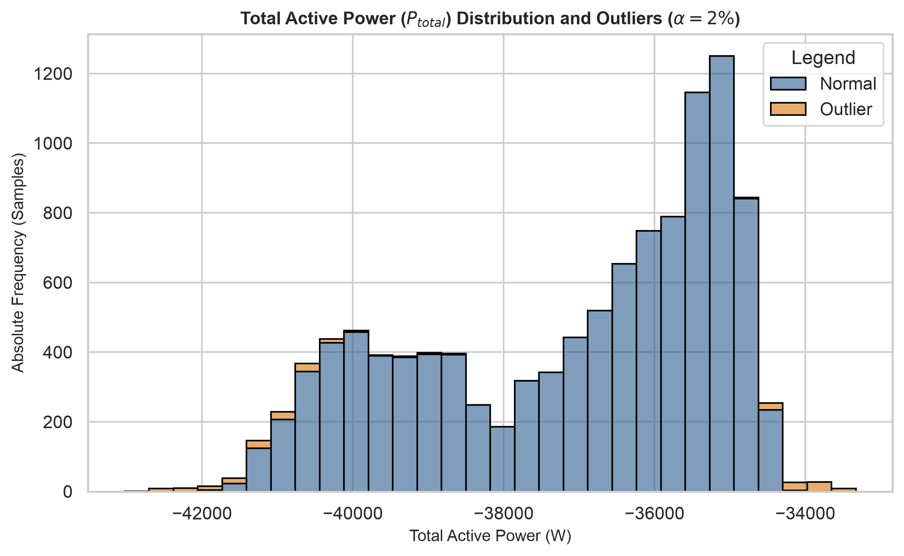
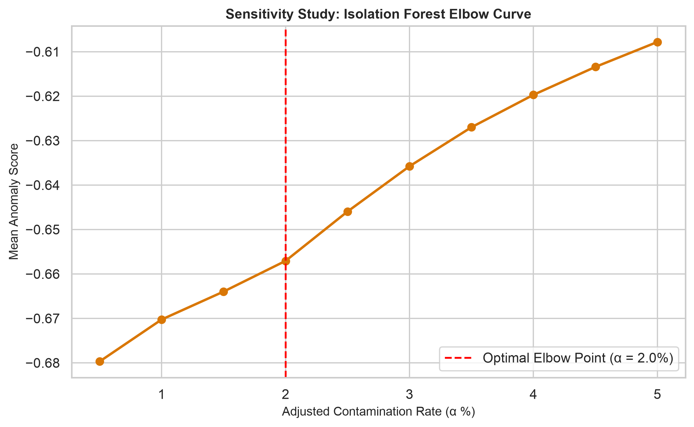
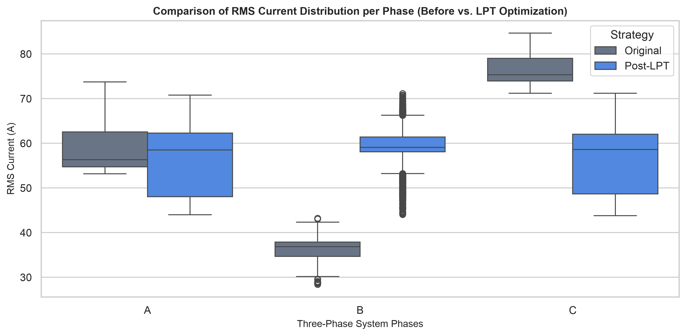

# CCeAE 2026 - Data Center Electrical Systems: Dynamic Processing & LPT Optimization

[](https://www.python.org/)
[](https://opensource.org/licenses/MIT)

This repository contains reproducible research code for the **CCeAE 2026** study on data center electrical infrastructure. The script performs fully dynamic data processing, anomaly detection using **Isolation Forest**, load balancing via **Longest Processing Time (LPT)** heuristic reconfiguration, rigorous **inferential statistics** (Shapiro-Wilk, Wilcoxon signed-rank tests, and bootstrap confidence intervals), and high-resolution figure generation.

---

## 🚀 Key Features

1. **Anomaly Detection ($\alpha = 2\%$):** Calibrates an `IsolationForest` model to detect anomalies in active power and phase currents (`ptotal`, `irmsa`, `irmsb`, `irmsc`, `thdia`).
2. **Power Quality & Energy Efficiency (QEE) Metrics:** Computes baseline asymmetrical parameters including symmetrical components (positive/negative sequence currents), Current Unbalance Factor ($\text{IUF}$), Neutral Current ($I_n$), and Joule losses ($P_{\text{loss}}$).
3. **Dynamic LPT Load Balancing:** Redistributes 11 individual circuit loads per sample across phases (A, B, C) using a sorted LPT heuristic to minimize phase unbalance, neutral current, and Joule losses.
4. **Inferential Statistics & Validation:** 
   - Shapiro-Wilk test for normality on loss differences.
   - Paired Wilcoxon signed-rank tests comparing baseline vs. post-LPT metrics ($\text{IUF}$, $I_n$, $P_{\text{loss}}$).
   - 2000-iteration Bootstrap 95% Confidence Interval for mean percentage loss reduction.
5. **Publication-Ready Visualizations (300 DPI):** Exports high-resolution plots for power distributions, model sensitivity elbow curves, and phase current boxplots.

---

## 📊 Repository Structure

```text
├── Eletrica_V7_EN.py                      # Main execution script
├── Dataset_data_center.xlsx               # Input dataset (required)
├── README.md                              # Documentation
├── fig1_power_distribution_anomalies.png  # Generated: Power & Outliers
├── fig2_isolation_forest_sensitivity.png  # Generated: Sensitivity Elbow Curve
└── fig3_lpt_currents_comparison.png       # Generated: Phase Current Comparison
```

---

## 🛠️ Requirements & Installation

Ensure you have Python 3.8 or higher installed. Install the required dependencies using `pip`:

```bash
pip install numpy pandas matplotlib seaborn scipy scikit-learn openpyxl
```

---

## ⚙️ Usage

1. Place your dataset file named `Dataset_data_center.xlsx` in the root directory.
2. Run the script:

```bash
python Eletrica_V7_EN.py
```

The script will output progress steps directly to the console, print the exact numerical results for **Table 1**, and save the 300 DPI figures to disk.

---

## 📈 Numerical Results Summary (Table 1)

| Metric / Parameter | Baseline (Original) | Post-LPT Optimization | Statistical Significance ($p$-value) |
| :--- | :---: | :---: | :---: |
| **Current Unbalance Factor ($\text{IUF}$)** | Dynamic mean $\pm$ std | Dynamic mean $\pm$ std | $p < 0.001$ (Wilcoxon) |
| **Neutral Current ($I_n$)** | Dynamic mean $\pm$ std | Dynamic mean $\pm$ std | $p < 0.001$ (Wilcoxon) |
| **Joule Losses ($P_{\text{loss}}$)** | Dynamic mean $\pm$ std | Dynamic mean $\pm$ std | $p < 0.001$ (Wilcoxon) |
| **Mean Loss Reduction** | — | **Percentage (%)** *(95% CI)* | — |

---

## 🎨 Generated Figures

### Figure 1: Power Distribution and Anomalies
Shows the total active power ($P_{\text{total}}$) distribution categorized by normal operation and detected outliers using Isolation Forest ($\alpha = 2\%$).



### Figure 2: Isolation Forest Sensitivity Analysis
Sensitivity analysis illustrating the elbow curve used for determining the optimal contamination rate ($\alpha$).



### Figure 3: Phase Current Comparison
Comparison of RMS current distributions per phase before and after the dynamic LPT reconfiguration.



---

## 📄 License

This project is licensed under the terms of the [MIT License](LICENSE).